 

Text summary

**João** — Full Stack, software and automation developer with Node.js projects (REST APIs, web dashboards, Discord bots and Mercado Pago integrations). Studying Python, artificial intelligence and cybersecurity.

**Projects:** [invite-system](https://github.com/Joaoopy/invite-system) · [zerobug-pay](https://github.com/Joaoopy/zerobug-pay) · [eden-guard](https://github.com/Joaoopy/eden-guard)

**Contact:** [jooaopy@gmail.com](mailto:jooaopy@gmail.com) · [GitHub](https://github.com/Joaoopy) · [Instagram](https://instagram.com/joaoowy7_)

