 

Resumo em texto

**João** — desenvolvedor Full Stack, de software e automação, com projetos em Node.js (APIs REST, painéis web, bots para Discord e integrações com Mercado Pago). Estudando Python, inteligência artificial e cibersegurança.

**Projetos:** [invite-system](https://github.com/Joaoopy/invite-system) · [zerobug-pay](https://github.com/Joaoopy/zerobug-pay) · [eden-guard](https://github.com/Joaoopy/eden-guard)

**Contato:** [jooaopy@gmail.com](mailto:jooaopy@gmail.com) · [GitHub](https://github.com/Joaoopy) · [Instagram](https://instagram.com/joaoowy7_)

